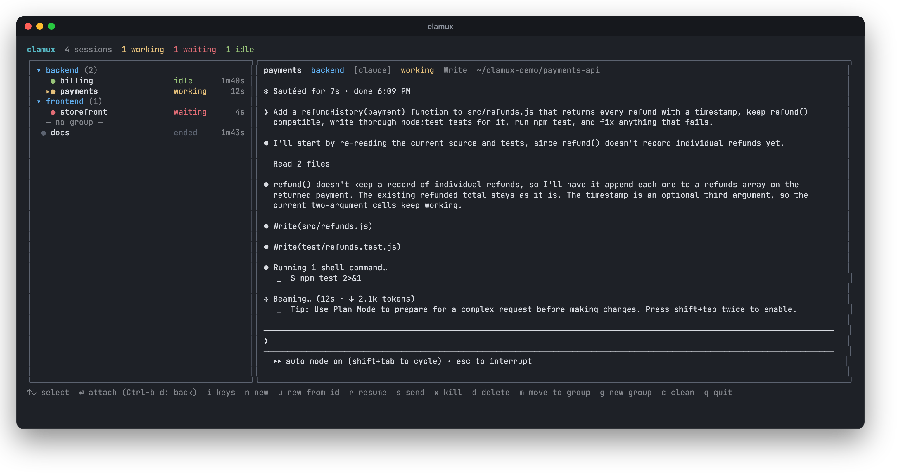
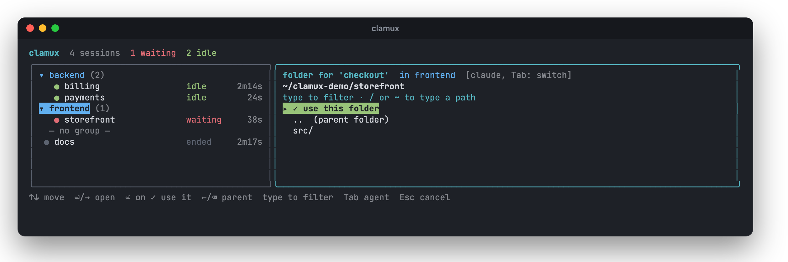
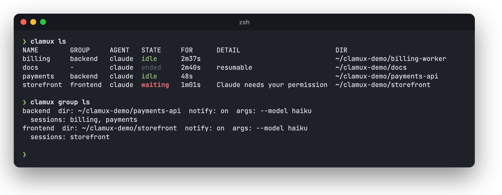

<div align="center">

# clamux

**Run a fleet of Claude Code sessions from one terminal, and drive them from your own code.**

A terminal dashboard, CLI, TypeScript SDK and MCP server for running many Claude Code and Antigravity CLI (`agy` / Gemini) sessions side by side, and seeing at a glance which ones are working, idle, or waiting for you.

[](https://www.npmjs.com/package/@renatex314/clamux)
[](https://nodejs.org)

[](LICENSE)

[Quick start](#quick-start) · [Dashboard](#dashboard) · [Groups](#groups) · [Accounts](#accounts) · [CLI](#cli) · [SDK](#sdk) · [MCP server](#mcp-server)



</div>

## Features

- **Live status for every session**: `working` (and on which tool), `idle`, `waiting` for you, `ended`. It comes from Claude Code's lifecycle hooks, not from scraping the screen.
- **A dashboard with a live preview** of the selected session. Attach to any session with `Enter`, detach with `Ctrl-b d`, or send keys and prompts without leaving the list.
- **Sessions outlive your terminal.** Each one runs in its own background process. Close the dashboard, reboot, or crash, and `resume` continues the same conversation.
- **Groups** with defaults for new sessions: the folder they start in, notifications, agent, arguments, and account.
- **Several Claude accounts** side by side, e.g. personal and work subscriptions, each session under the one you pick.
- **Desktop notifications** when a session finishes or needs your permission.
- **A typed SDK**: `ask()` a session something and get Claude's reply as plain text, or `watch()` every state change.
- **An MCP server**, so Claude Code itself can start sessions and delegate work to them.
- **Claude Code and Antigravity CLI** (`agy`), natively on macOS, Linux and Windows. No tmux needed.

## Quick start

```bash
npm install -g @renatex314/clamux
clamux                                  # open the dashboard, press n for a new session
```

Or from the command line:

```bash
clamux new api ~/code/api -d            # start a session in the background
clamux send api "add pagination to GET /orders"
clamux ls                               # what is everyone doing?
clamux attach api                       # jump in (Ctrl-b d to leave)
```

Requires Node 20+ and the `claude` CLI (or `agy`) on your PATH. For the SDK, add it to your project instead: `npm install @renatex314/clamux`.

## Dashboard

`clamux` with no arguments opens the dashboard: sessions on the left (grouped, with their state and how long they have been in it), and a live preview of the selected one on the right.

<details>
<summary><b>Keys</b></summary>

| Key | Action |
|---|---|
| `↑` `↓` / `j` `k` | select a session or a group |
| `Enter` | attach to it; press `Ctrl-b` then `d` to detach and come back to the dashboard. On a group: fold or unfold it |
| `n` | new session: asks for a name, then opens a folder picker (`↑` `↓` move, `Enter`/`→` open a folder, `Enter` on "✓ use this folder" picks it, `←`/`Backspace` go up, type to filter, or type a path starting with `/` or `~`); while typing the name, `Tab` switches between `claude` and `agy` and `↑` `↓` pick the [account](#accounts) |
| `u` | new session that continues an existing conversation: asks for a name, then a Claude session UUID (or an agy conversation id); it starts in the directory that conversation ran in |
| `i` | send keys: every key (`Esc`, `Ctrl-c`, arrows...) goes to the selected session while the dashboard stays on screen; `Ctrl-b` then `d` stops, `Ctrl-b` `Ctrl-b` sends a literal `Ctrl-b` |
| `s` | type a prompt into the selected session (asks first if it is busy) |
| `r` | resume the selected session if it is not running |
| `x` | kill the selected session (it stays saved, so `r` brings it back) |
| `d` | delete the selected session and its saved record |
| `g` | new group: asks for a name, then the folder its sessions start in (`Tab` picks the agent), then whether they notify |
| `e` | edit the selected group (or the selected session's group) |
| `m` | move the selected session to another group, or out of its group |
| `d` on a group | delete the group; its sessions stay, without a group |
| `c` | remove leftover status entries |
| `q` | quit (sessions keep running) |

</details>

## Groups

Groups collect sessions under a heading and give the sessions created in them defaults: the folder they start in, whether they notify, the agent, and extra agent arguments. Press `n` with a group (or a session in it) selected, and the folder picker opens at the group's folder, so `Enter` takes it.

<p align="center"></p>

```sh
clamux group set web --dir ~/projects/web --no-notify -- --model opus   # create, or change only the options given
clamux group set web -A work                                           # its sessions run under the `work` account
clamux group set web -a agy                                            # --no-dir / --no-args remove a default
clamux new api -g web -d                                               # starts in ~/projects/web, no notifications
clamux group move api other                                            # or `clamux group move api` to ungroup it
clamux group ls
clamux group rm web                                                    # its sessions keep running, ungrouped
```

Options you pass explicitly win over the group's, and changing a group only affects sessions created afterwards. Groups live in `~/.clamux/groups.json`; a session's group is kept in its saved record.

## Accounts

Run sessions under different Claude accounts at the same time, for example a personal and a work subscription. An account is a Claude Code config directory of its own (`CLAUDE_CONFIG_DIR`), so it has its own login, usage limits and conversation history. Sessions without one use your normal login.

```sh
clamux account add work            # creates ~/.clamux/accounts/work
clamux account login work          # opens Claude Code in it: log in, then /exit
clamux new api ~/code/api -A work  # or pick it with ↑↓ in the dashboard, or set it on a group
clamux account ls                  # every account and who it is logged in as
```

A new account shares your default one's `settings.json`, `CLAUDE.md`, skills, agents, commands and plugins (as links, so changes show up in both) and starts with a copy of its user-scope MCP servers; pass `--no-share` for a clean one. To use a config directory you already have, pass it with `--dir`. A session keeps its account when it is resumed, and `-s <session id>` looks the conversation up in that account. `clamux account rm` only unregisters an account: its directory, with its login and conversations, stays on disk. Accounts apply to Claude Code; agy has its own login.

## CLI

<p align="center"></p>

| Command | |
|---|---|
| `clamux new <name> [dir] [-g <group>] [-A <account>] [-a claude\|agy] [-s <session id>] [-d] [--notify\|--no-notify] [-- <agent args>]` | start a session (and attach, unless `-d`) |
| `clamux ls` | every session with its group, agent, state and directory |
| `clamux attach <name>` | connect your terminal to it; `Ctrl-b d` detaches |
| `clamux send <name> <prompt...> [--force]` | type a prompt into it (refuses if it is busy, unless `--force`) |
| `clamux peek <name>` | print its screen |
| `clamux kill <name>` | stop it; it stays saved and can be resumed |
| `clamux resume <name> [-d]` / `resume --all` | restart a saved session (or all of them), continuing its conversation |
| `clamux forget <name>` | delete a stopped session and its saved record |
| `clamux group ls\|set\|rm\|move` | manage [groups](#groups) |
| `clamux account ls\|add\|login\|rm` | manage Claude [accounts](#accounts) |
| `clamux config [skip-permissions on\|off]` | [settings](#settings) for every session |
| `clamux clean` | remove status files of sessions that are gone |
| `clamux notify` | show a test desktop notification (and why it failed, if it did) |
| `clamux setup [--remove]` | register the [MCP server](#mcp-server) and its skill with Claude Code and agy |
| `clamux mcp` | run the MCP server on stdio |

## SDK

The package exports a typed client for driving sessions from your own code. Sessions are the same ones the dashboard shows, so a script can talk to a session you have open, and you watch it happen.

```ts
import { Clamux, ClamuxError } from "@renatex314/clamux";

const cx = new Clamux();
await cx.create("refactor", { dir: "~/projects/app" }); // detached; notify defaults to false here
await cx.waitForIdle("refactor");                       // wait for Claude to start up

const { answer } = await cx.ask("refactor", "Rename foo to bar", { timeoutMs: 120_000 });
console.log(answer);                                    // Claude's final reply, as plain text

for await (const change of cx.watch()) {                // every state change, until you abort
  console.log(change.name, change.from, "->", change.to);
}
```

<details>
<summary><b>API reference</b></summary>

| Method | |
|---|---|
| `list()` / `get(name)` | session snapshots: `name`, `state`, `detail` (current tool), `ageS`, `cwd`, `group`, `account`, `live`, `sessionId`, `transcriptPath`, `resumable` |
| `create(name, { dir, agent, sessionId, group, account, notify, claudeArgs })` | start a session (async); `sessionId` continues an existing conversation; `group` fills in what is left out from the group's defaults; `account` runs it under another Claude login |
| `groups()` / `setGroup(name, { dir, notify, agent, args, account })` / `removeGroup(name)` / `moveToGroup(name, group \| null)` | manage groups (`null` clears a default) |
| `accounts()` / `addAccount(name, { dir, share })` / `removeAccount(name)` | manage Claude accounts; each new one logs in once with `clamux account login` |
| `send(name, prompt, { force })` | type a prompt; throws `BUSY` if the session is working/waiting |
| `ask(name, prompt, opts)` | `send` then wait until Claude finishes that turn (working -> idle); returns `{ session, answer, screen, transcriptPath }`, where `answer` is Claude's final reply as plain text |
| `lastAnswer(name)` | Claude's most recent reply in the session (read from its transcript), or `null` |
| `waitFor(name, predicate, { timeoutMs, pollMs, signal })` / `waitForIdle` | wait for a condition |
| `press(name, ...keys)` | key names (`Enter`, `Down`, `Escape`, `C-c`, ...) or literal text, e.g. `press("x", "y")` to answer a permission prompt |
| `screen(name)` | the exact screen right now (async) |
| `peek(name)` | the screen from a file refreshed ~8x/second (sync, may trail slightly) |
| `watch({ pollMs, signal })` | async iterator of `{ name, from, to, session }` |
| `kill(name)` | stop a session; it stays saved (`resumable: true`) |
| `resume(name)` | restart a saved session and continue its conversation; returns `{ session, resumed }` |
| `forget(name)` | delete a stopped session and its saved record (`BUSY` if it is running) |
| `attach` / `clean` | as in the CLI (`attach` is async) |

Errors are `ClamuxError` with a `code`: `INVALID`, `EXISTS`, `NOT_FOUND`, `BUSY`, `TIMEOUT`, `ABORTED`, `HOST_FAILED`.

- `answer` is the text of Claude's final reply, read from the session transcript (tool calls and earlier commentary in the same turn are left out). It is `null` if the transcript could not be read; `screen` is the whole interface as a fallback. For the full conversation, read the JSONL at `transcriptPath`.
- If Claude stops to ask permission the session sits in `waiting`, so `ask()` will time out. Use `watch()` to notice it and `press()` to answer, or set `timeoutMs`.
- Sessions you create stay alive after your script exits; `kill` them when done.
- The SDK and the dashboard share the same sessions as long as they run as the same user (same home directory, and the same `CLAMUX_HOME` if you set one).

</details>

## MCP server

`clamux mcp` runs clamux as an [MCP](https://modelcontextprotocol.io) server on stdio, so Claude Code (or any MCP client) can create and drive sessions itself: "split this refactor across three sessions and report back".

```bash
npm install -g @renatex314/clamux
clamux setup
```

`clamux setup` registers the server for all your projects (`claude mcp add --scope user`) and installs a skill at `~/.claude/skills/clamux/` that tells Claude when and how to use the tools: the create/ask/kill workflow, parallel and long tasks, what each state means, and to show you permission and folder-trust prompts rather than approving them blindly. Restart Claude Code (or run `/mcp`) afterwards. `clamux setup --remove` undoes both. It is safe to run again after upgrading; it replaces the earlier registration and skill. When `agy` is on your PATH it is configured too.

The registered command is `clamux mcp` when `clamux` is on your PATH, otherwise the absolute path of the install that ran `setup`. It only touches the user-scope MCP registration and `~/.claude/skills/clamux/`; your `settings.json` is not modified.

<details>
<summary><b>Other clients and manual setup</b></summary>

```bash
claude mcp add clamux -- npx -y @renatex314/clamux@latest mcp
```

Use `@latest` as shown: when the current directory is this very project, a bare `npx @renatex314/clamux` runs the local checkout instead of downloading the package, and fails if it is not linked.

Other clients: `{ "mcpServers": { "clamux": { "command": "npx", "args": ["-y", "@renatex314/clamux@latest", "mcp"] } } }`.

</details>

| Tool | |
|---|---|
| `list_sessions` | all sessions with state (`working`, `idle`, `waiting`, ...), group, and whether they are `resumable` |
| `list_groups` | groups with their defaults and sessions |
| `list_accounts` | Claude accounts sessions can run under, and who each is logged in as |
| `create_session` | start a session in a directory (`name`, `dir`, `agent`, `session_id`, `group`, `account`, `claude_args`, `notify`) |
| `ask` | send a prompt, wait for Claude to finish, return its final reply as text |
| `send_prompt` / `wait_for_session` / `get_answer` | the same in separate steps: send and return, wait until it stops working, read the latest reply |
| `read_screen` / `press_keys` | see the terminal and send keystrokes, e.g. to answer a permission prompt |
| `kill_session` / `resume_session` / `forget_session` | stop (stays saved), continue the conversation later, delete for good |

Long waits don't fail: if a session is still working at the timeout, or stops on a permission prompt or the first-time folder-trust prompt, the tool returns its state and screen with a hint, and the caller continues with `wait_for_session` or `press_keys`. Errors are tool errors prefixed with the code (`NOT_FOUND`, `BUSY`, ...). Sessions keep running after the MCP server exits.

> [!WARNING]
> Whoever can call these tools can make Claude Code run prompts (and so tools) in any directory you can reach. Add the server only to clients you trust.

## Saved sessions

Every session is saved when you create it: `~/.clamux/saved/<name>.json` records its directory, the agent arguments, whether it notifies, and the id of the conversation it holds (kept current by the hooks, so it follows `/clear`). Killing a session, rebooting, or a crash only stops the process. The record stays, and the session shows in the list as `ended` or `dead` with `resumable`. `clamux resume <name>` (or `r` in the dashboard) starts it again with `claude --resume <id>`, so the conversation continues where it left off. `clamux resume --all` restarts everything that is not running, e.g. after a reboot.

A conversation you started outside clamux can be brought in too: `clamux new <name> -s <session uuid>` (or `u` in the dashboard, or `sessionId` / `session_id` in the SDK and MCP server) starts a session with `claude --resume <uuid>` in the directory that conversation ran in, found from its transcript under `~/.claude/projects`. With `-a agy` it takes an agy conversation id and uses `agy --conversation <id>`.

If the session never had a conversation (nothing was sent before it stopped), there is nothing to resume, so it starts fresh with the same directory and arguments. `forget` (`d` in the dashboard) deletes the record; a name that is still saved cannot be reused by `new` until then.

## Notifications

A desktop notification fires when a session goes from working to idle, or needs your permission (macOS: Notification Center with a sound; Windows: toast; Linux: `notify-send`). Pass `--no-notify` to `new`, or set it on a group, to turn it off. Sessions started from the SDK or the MCP server only notify when created with `notify: true` (or in a group that notifies). `clamux notify` shows a test notification and prints why it failed, if it did; errors from sessions' notifications go to `~/.clamux/notify.log`.

## Settings

`clamux config skip-permissions on` starts every Claude Code session with `--dangerously-skip-permissions` (agy sessions always run that way). It applies whenever a session starts or is resumed, so `off` takes effect on the next resume too; to use it for some sessions only, give a group the flag instead (`clamux group set <group> -- --dangerously-skip-permissions`). Claude Code asks you to confirm bypass mode the first time: attach to the session (or read its screen) and accept it once. `clamux config` shows the current settings, kept in `~/.clamux/config.json`.

Everything clamux keeps lives in `~/.clamux`. Set `CLAMUX_HOME` to use another directory, for a separate set of sessions (for example for tests or demos).

## How it works

Status comes from lifecycle hooks. For Claude Code, they are loaded per session with `claude --settings ~/.clamux/settings.json` (`~/.claude/settings.json` is never touched). For Antigravity CLI (`agy`), they are registered under the `"clamux"` key in `~/.gemini/config/hooks.json` and only report status for sessions started through clamux (`CLAMUX_NAME` in the environment).

Each session is a small detached host process (`clamux host <name>`) that owns the agent through a pseudo-terminal and keeps a virtual screen of what it draws. The host listens on a unix socket (a named pipe on Windows). `attach` connects your terminal to it (replaying the current screen first), `send` and `press` write input to it, and the host also keeps a plain-text copy of the screen in `~/.clamux/run/` so the dashboard preview and `peek` are cheap. Sessions keep running when you close the dashboard or your terminal.

A prompt from `send` (or `s`, `ask`, `send_prompt`) goes in as a bracketed paste, the way a terminal pastes text, so its newlines and characters like `#`, `!` or `/` are text rather than keystrokes. Enter is pressed once the agent has drawn it, and if it never shows up nothing is submitted and `send` fails.

On Windows the host uses the ConPTY that ships with node-pty (the one Windows Terminal uses) instead of the older one built into Windows, which leaves stray characters behind when Claude Code scrolls; set `CLAMUX_CONPTY_DLL=0` to go back to the built-in one.

### States

| State | |
|---|---|
| `working` | busy, with the current tool |
| `idle` | done, waiting for the next prompt |
| `waiting` | needs permission or an answer from you |
| `starting` | not ready yet, e.g. sitting on the folder-trust prompt |
| `stale?` | working, but no event for 15 minutes |
| `dead` | the session host vanished |
| `ended` | stopped; `resumable` if it can be brought back |

## Development

```bash
npm install
npm run build
ln -s "$PWD/dist/cli.js" ~/.local/bin/clamux   # optional (macOS/Linux): run `clamux` from anywhere
```

On Windows, run `npm link` instead (or call `node dist\cli.js`). `node-pty` provides the pseudo-terminal. It ships prebuilt binaries for macOS and Windows; on Linux it compiles on install, so you need a C++ toolchain (`build-essential` or equivalent).

`npm run typecheck` checks types; `npm run build` bundles to `dist/` and emits type declarations; `npm test` builds and runs the tests. They use a fake `claude`, an isolated `HOME` and real pseudo-terminals, so they never touch your real sessions or your subscription.

<details>
<summary><b>Source layout</b></summary>

- `src/hook.ts`: the hook Claude Code calls on each event; writes `~/.clamux/status/<name>.json`
- `src/status.ts`: reads status files and derives the displayed state
- `src/host.ts`: the per-session host: pty, virtual screen, socket server
- `src/sessions.ts`, `src/registry.ts`, `src/attach.ts`: create / resume / send / kill / attach, and discovering live sessions
- `src/saved.ts`, `src/groups.ts`, `src/accounts.ts`, `src/config.ts`: the per-session records that make resuming possible, groups, accounts, and settings
- `src/ipc.ts`, `src/keys.ts`, `src/notify.ts`, `src/env.ts`: protocol framing, key names, desktop notifications, environment hygiene
- `src/tui.tsx`, `src/dirpicker.tsx`: the Ink dashboard (loaded lazily so hooks start fast) and its folder picker
- `src/cli.ts`: entry point and subcommands
- `src/client.ts`, `src/index.ts`, `src/errors.ts`, `src/transcript.ts`: the SDK
- `src/mcp.ts`: the MCP server (`clamux mcp`); `src/setup.ts`, `src/skill.ts`: `clamux setup` and the skill it installs

</details>

## License

[MIT](LICENSE)
